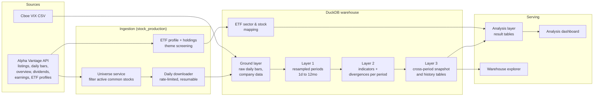

# StockDB: US Equity Market Data Warehouse & Analytics Framework

An end-to-end, self-built pipeline that downloads daily market data for the whole US equity market, organises it into a layered DuckDB warehouse, computes multi-timeframe technical indicators and divergence signals, and serves the results through read-only Streamlit dashboards.

> **About this repository.** This is a partial release of a personal research project. A few infrastructure modules are published in full as code samples; the rest of the project is shown as a skeleton (structure, classes and function interfaces with docstrings, implementations omitted). My proprietary research (signal definitions, market-regime rules, scoring, screening criteria) is kept private. **Full code is available for review on request.**
>
> Published in full: `stock_production/config.py`, `stock_production/tables.py`, `stock_production/clients/alpha_vantage.py`, `stock_production/services/resume_checkpoint.py`, `stock_production/services/asset_universe.py`.

---

## What it does

| | |
|---|---|
| **Coverage** | ~6,300 active US common stocks plus a themed ETF universe, refreshed every trading day |
| **Timeframes** | Daily bars resampled to weekly, monthly, quarterly, half-year and yearly |
| **Warehouse** | Single DuckDB file (~4.7 GB), rebuilt incrementally by scheduled jobs |
| **Indicators** | RSI, MACD, Stochastic, Momentum, CCI, OBV, VW-MACD, CMF, MFI, VWMA20, period returns |
| **Signals** | Regular (classic) bullish / bearish divergence across nine indicators and six timeframes |
| **Context data** | VIX (Cboe), AUD/USD, US 10-year yield, S&P 500 breadth proxies (% above 50/200-day SMA) |
| **Serving** | Two Streamlit apps: an analysis dashboard and a warehouse/lineage explorer |
| **Scheduling** | macOS launchd job that wakes the machine after the US close and runs the whole chain |

## Architecture



### Pipeline steps (daily stock job)

1. **Universe**: intersect the current Alpha Vantage listing with symbols that have a verified company overview; exclude ETFs, warrants, units, rights and test symbols.
2. **Download**: stream every ticker's full daily history into one combined CSV. Requests are paced at 70/min, failed tickers retry three times, and a checkpoint file lets an interrupted run resume where it stopped.
3. **Load**: import into DuckDB in date order.
4. **Resample**: build weekly to yearly bars in SQL. Each day is adjusted for splits and dividends *before* aggregation, so a split inside a month does not mix pre- and post-split share bases.
5. **Clean**: exclude tickers with missing, zero or sub-penny prices.
6. **Adjust**: compute adjusted daily OHLCV (factor = adjusted close / close).
7. **Indicators**: per ticker, per period (pandas-ta).
8. **Divergences**: pivot detection and regular divergence scan for nine indicators (`services/divergence_calculator.py`).
9. **Derived tables**: real dividend yield, a latest cross-period snapshot per ticker, and a cross-period history table.

Every step is recorded in a resume file, so a failure at step 8 restarts at step 8 rather than re-downloading data.

## Repository layout

```
stock_production/
  config.py                 Immutable runtime config; secrets come from .env / environment
  tables.py                 Validated, environment-configurable table-name registry
  clients/alpha_vantage.py  Shared HTTP client: key injection, pacing, error checks
  services/
    asset_universe.py       Listing download and filtering
    resume_checkpoint.py    Checkpoint / resume support for long jobs
    technical_indicators.py Indicator calculations (shared by stocks and ETFs)
    divergence_calculator.py Pivot + regular divergence detection
  pipelines/stock_daily_update.py   Orchestrates the daily stock job
  stock_market_data_monthly_update.py  Company overview, dividends, earnings calendar
  etf_preview_update.py     ETF themes, profiles, screening, sector/holding mapping
  etf_trading_daily_update.py  ETF daily bars, indicators, divergences
  analysis_dashboard/
    market_context_update.py  VIX, FX, yields, breadth proxies
    analysis.py             Example analysis layer (theme breadth)
    app.py                  Example dashboard
database_viewer/app.py      Warehouse explorer: tables, columns, lineage, sample rows
launchers/                  One-command runners and the launchd schedule
examples/                   Sample ETF theme file
```

## Design choices worth noting

- **Layered warehouse.** Raw, resampled, enriched and serving tables are kept separate, so each layer can be rebuilt independently and the dashboard never reads half-written data. Result tables are written to a staging table and swapped in a single transaction.
- **Daily-only resampling.** Weekly and longer bars are derived from adjusted daily bars instead of separate API calls, which removes duplicated data and keeps every timeframe consistent.
- **Resumable by default.** Long downloads (thousands of tickers under a rate limit) survive network errors, rate-limit stops and machine sleep.
- **No secrets in code.** The API key is read from the environment or a git-ignored `.env`; the HTTP client never echoes the credential URL in errors.
- **Configurable naming.** All table names are generated by `TableNames` and validated as SQL identifiers, so the schema can be renamed from `.env` without touching SQL.
- **Known limitation, stated explicitly.** Breadth proxies are back-filled from *current* index constituents, which introduces survivorship bias; the dashboard labels them as proxies.

## Tech stack

Python · DuckDB (SQL) · pandas · NumPy · pandas-ta · Streamlit · Altair · launchd

---

Shared for portfolio review; all rights reserved.
